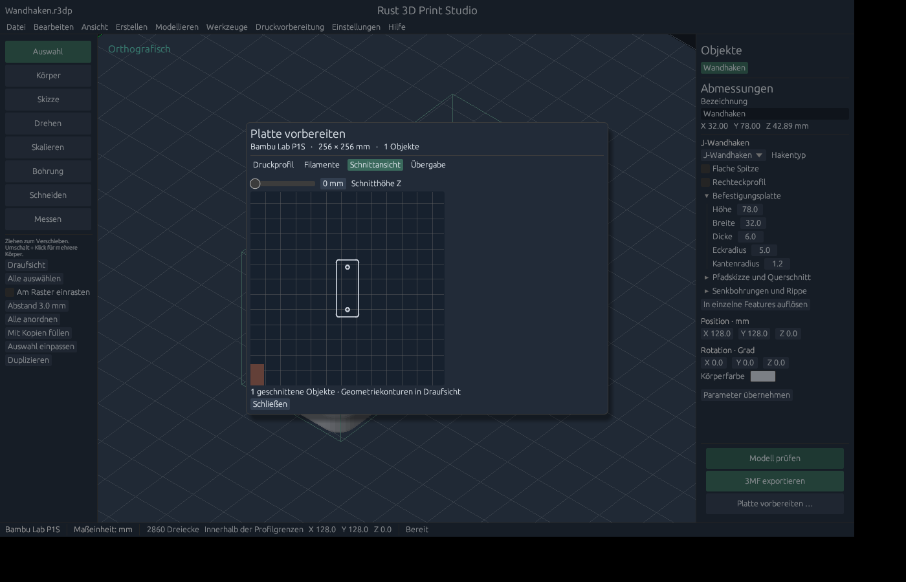

# Funktionsvergleich mit SimplyPrint

Die folgende Tabelle dokumentiert den historischen Vergleich für 0.4. Seit 0.5 arbeitet die Anwendung lokal. Die Browserverknüpfung ist entfernt und der lokale CLI-Prozess ist implementiert. Den aktuellen Arbeitsablauf beschreibt USER_MANUAL.md.

SimplyPrint betreibt die offizielle Bambu-Studio-Engine auf eigenen Servern und setzt eine eigene Browseroberfläche davor. Für die Desktopanwendung übernehmen wir den Arbeitsablauf mit einer lokalen Projektübergabe. Die Oberfläche gliedert eine Platte in Druckprofil, Filamente, Schnittansicht und Übergabe. Bambu Studio bleibt eine separat installierte Anwendung.

| Funktion der Referenz | Verfügbarer Weg in 0.4 | Weiterer Integrationsweg |
|---|---|---|
| Platte mit mehreren Teilen vorbereiten | Auswahl, Kopien, Verschieben, automatisches Belegen und Modellprüfung direkt im CAD. Die Übergabe erhält Weltkoordinaten und einzelne Körper. | Mehrere Platten pro CAD-Projekt ergänzen. |
| Drucker-, Filament- und Prozessprofile | Vollständige globale Einstellungen einer eigenen ungeslicten P1S-Projektvorlage übernehmen. Schichthöhe, Füllung, Wandlinien und Stützen direkt ändern. Andere Prozessparameter im offiziellen Slicer bearbeiten. | Weitere Maschinen einzeln mit kompatiblen Bettkonturen und Referenzprojekten abnehmen. |
| Mehrfarben und AMS | Filamentprofile mit Farbmuster anzeigen, Objekten Nummern zuweisen, Zuordnungen exportieren. Flächen bemalen und Filamentnummern physischen AMS-Fächern zuordnen in Bambu Studio. | Dreiecksgenaues Bemalen benötigt persistente Flächen-IDs und eine Abnahme bei Neutessellierung. |
| Slicing und Vorschau | Schnittkonturen in frei wählbarer Z-Höhe im CAD ansehen. Offizielles lokales Bambu Studio öffnen, dort slicen und die tatsächlichen Werkzeugwege prüfen. | Für eingebettetes Slicing einen versionierten CLI-Arbeitsprozess mit Fortschritt, Abbruch und Auslesen des Slicer-Ergebnisses implementieren. |
| Browser, Smartphone, Tablet und Chromebook | Im Reiter Übergabe die SimplyPrint-Seite öffnen. Für den Online-Slicer die exportierte Datei selbst im eigenen Konto auswählen. | Eine vollständig lokale Browseroberfläche benötigt einen gesonderten Client und einen ausdrücklich gestarteten lokalen Dienst. |
| Cloudspeicher und Profilimport | Extern im SimplyPrint-Konto. Lokale R3DP- und 3MF-Dateien bleiben separat verfügbar. | Für einen internen Connector Kontoautorisierung, Dateiauswahl und expliziten Upload implementieren. |
| Warteschlange und Druckerflotte | Extern in SimplyPrint, je nach Tarif. | Die öffentliche API dokumentiert Drucker- und Farmübersichten sowie Aufträge. Zuerst lesenden Statuszugriff integrieren. |
| Kamera, Fernüberwachung, Filamentbestand | Extern bei eingerichtetem Drucker im Dienst. | Kamera-Snapshots, Geräte- und Spulendaten über autorisierte API-Aufrufe anzeigen. |
| Übermittlung an den Drucker | Manuell im gewählten Slicer bzw. in SimplyPrint. Die Bedienung in Rust Studio endet bei der Dateiübergabe. | Eine optionale SimplyPrint-Verbindung benötigt laut Anbieter für Bambu-Drucker dessen lokale Bridge. |
| Gerätespezifische Funktionen | Die Fähigkeiten des physischen Druckers und des aktiven Profils bestimmen die Optionen in Bambu Studio. | Funktionen weiterer Geräte nur nach Profil- und Geräteprüfung anbieten. |

Die Dokumentation der SimplyPrint-API enthält auch „Send to SimplyPrint“. Dieser Weg benötigt eine abrufbare Modelldatei-URL. Für rein lokale CAD-Dateien bleibt die manuelle Dateiauswahl der verwendete Weg. Eine Verbindung mit Konto oder Drucker ist in Rust Studio 0.4 nicht eingerichtet.

Quellen, abgerufen am 20. November 2026

- [SimplyPrint – BambuStudio Online](https://simplyprint.io/de/features/slicer/bambustudio)
- [SimplyPrint API Reference](https://apidocs.simplyprint.io/)
- [Offizielles Bambu-Studio-Projekt](https://github.com/bambulab/BambuStudio)
